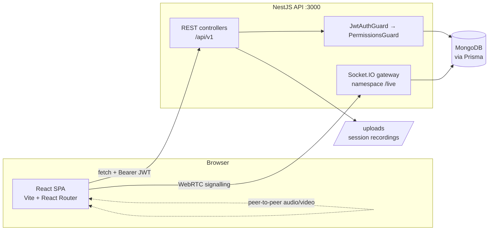
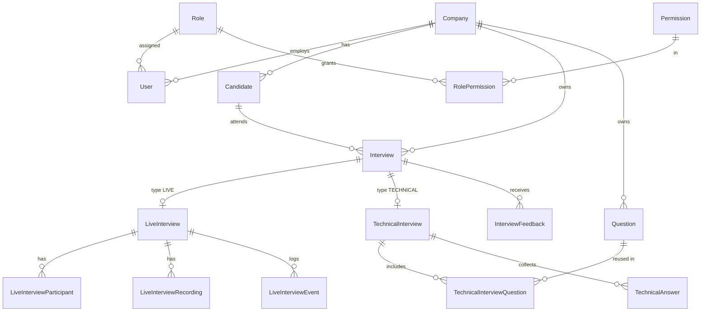

# Architecture

How the Interview Management Platform is put together, and the conventions to
follow when adding to it.

## System overview



Audio and video never touch the server. The gateway only relays WebRTC
signalling (offer, answer, ICE candidates); the media stream is peer-to-peer
over public STUN. There is no TURN server, so peers behind symmetric NAT will
fail to connect — that is a known limitation, not a bug.

## Tech stack

| Layer | Choice | Why |
| --- | --- | --- |
| API | NestJS 11 | DI, guards and modules map cleanly onto RBAC |
| ORM | Prisma 6 | Typed queries; schema split one model per file |
| Database | MongoDB | Document store (replica set for nested writes) |
| Realtime | Socket.IO 4 | WebRTC signalling with JWT handshake auth |
| Auth | Passport JWT, bcrypt | Access + refresh tokens, hashed at rest |
| Frontend | React 19, Vite 6 | Fast dev loop, no framework lock-in |
| Routing | React Router 7 | Nested layout + guard routes |
| Styling | Plain CSS with custom properties | No runtime cost, themeable via tokens |

There is deliberately no state-management library and no CSS framework. Server
state is fetched per page through `useAsyncData`; the little shared client state
that exists (auth, theme, toasts) lives in React context.

## Backend

### Module map

Every feature is a NestJS module owning its own controller, service and DTOs.

| Module | Route prefix | Responsibility |
| --- | --- | --- |
| `auth` | `/auth` | Login, refresh, logout, password reset, profile |
| `dashboard` | `/dashboard` | Aggregated counts and activity feed |
| `interviews` | `/interviews` | Scheduling across all interview types |
| `live-interview` | `/live-interviews` | Live sessions, lobby, recordings, feedback |
| `technical-interview` | `/technical-interviews` | Assessments, attempts, grading |
| `question-bank` | `/questions` | Reusable question CRUD |
| `candidates` | `/candidates` | Candidate records and history |
| `reports` | `/reports` | Analytics and CSV export |
| `settings` | `/settings` | Profile, company, roles |
| `prisma` | — | Global `PrismaService` |

`interviews` is the orchestrator: creating an interview writes the `Interview`
row and then delegates to `live-interview` or `technical-interview` to create
the matching session. Feature modules never reach into each other's tables
directly.

### Request pipeline

```
Request
  → ThrottlerGuard        (global rate limit)
  → JwtAuthGuard          (global; @Public() opts out)
  → PermissionsGuard      (global; @RequirePermissions() declares the need)
  → ValidationPipe        (whitelist + forbidNonWhitelisted + transform)
  → Controller
  → Service
  → GlobalExceptionFilter (uniform error body)
```

### Conventions

- **Response shape is uniform.** Controllers return
  `ApiResponseDto.ok('Message.', data)`, which serialises to
  `{ success, message, data }`. Never return a bare object.
- **Controllers stay thin.** They validate, call one service method, wrap the
  result. All business rules live in services.
- **Authorisation is declarative.** Put `@RequirePermissions('Candidate.Edit')`
  on the handler. Do not hand-roll role checks in controllers.
- **Scope every query by company.** Use the shared helpers in
  `src/common/` rather than repeating `where: { company_id }` logic. A Super
  Admin is the only role that sees across companies. Custom roles created in
  Settings are company-scoped staff (same interview reach as HR), not
  interviewer-only.
- **DTOs own validation.** Use `class-validator` decorators; the global
  `ValidationPipe` rejects unknown properties, so every accepted field must be
  declared.
- **One Prisma file per model.** Add or change models under `prisma/schema/`
  (for example `user.prisma`). Field names stay snake_case (`created_at`,
  `recorded_by_id`); do not use camelCase columns. Enums live in `enums.prisma`; generator and MongoDB
  datasource live in `_base.prisma`.

## Frontend

### Directory layout

```
src/
  auth/          AuthContext: session, permissions, login/logout
  components/
    ui/          Shared UI kit — the only place generic components live
    *Route.tsx   Route guards (authenticated, live guest, technical guest)
  config/        Navigation modules and their required permissions
  hooks/         Cross-page hooks (useAsyncData, useLiveRoom, useSessionRecorder)
  layouts/       AppShell: sidebar navigation + outlet
  lib/           api client, token/guest storage, formatting helpers
  pages/         One file per route
  styles/        tokens.css (theme) + ui.css (kit styles)
  theme/         ThemeProvider: light/dark, persisted
  types/         Shared response and input types, mirroring backend DTOs
```

### The UI kit

`src/components/ui` is the shared vocabulary: `Button`, `Modal`, `EmptyState`,
`StatusPill`, `Skeleton`/`SkeletonList`, `Pagination`, `ThemeToggle` and the
toast provider. Components wrap the existing CSS class names rather than
introducing new styling, so markup gets shorter without the design shifting.

Rules:
- Pages compose kit components; they should not hand-write `modal-backdrop`,
  `empty-state` or raw `*-btn` markup.
- Anything used by two or more pages belongs in the kit. Anything used once
  stays in the page.
- Kit components never import from `pages/` or `lib/api`.

### Data loading

`useAsyncData(fetcher, deps, options)` is the single pattern for reading server
state. It tracks `loading` and `error`, exposes `reload()`, and discards
responses from superseded requests so a slow reply to an old search term cannot
overwrite a newer one. Pass `debounceMs` for search-as-you-type.

### Feedback

- **Load failures** render inline as an `alert` block with a Retry action, because
  the page has no content to show.
- **Action results** ("Candidate updated", "Delete failed") go through
  `useToast()`, because the page still shows valid content underneath.

### Theming

All colour, spacing, radius and type values are custom properties defined in
`src/styles/tokens.css`. The dark theme overrides the same names under
`[data-theme='dark']`, which `ThemeProvider` sets on `<html>`. Never hard-code a
hex value in a component or page style — add a token.

## Data model



`Interview` is the spine. It holds the schedule (`scheduledAt`, `endsAt`,
`durationMinutes`), the people, and the status. `LiveInterview` and
`TechnicalInterview` are optional one-to-one extensions carrying the mechanics of
each format. A `COMBINED` interview has both.

## Access control

Five roles, each a bundle of permission codes shaped `Module.Action` (for example
`Interview.Create`, `TechnicalInterview.Review`). Permissions are rows in the
database, not constants in code, so a role's reach can change without a deploy.

| Role | Reach |
| --- | --- |
| Super Admin | Every company, every permission |
| Company Admin | One company, every permission |
| HR | Schedule interviews, manage candidates and questions, view reports |
| Interviewer | Conduct assigned interviews, record, submit feedback |
| Candidate | Attend only interviews assigned to them |

The sidebar is filtered by the same permission codes the API enforces, so users
never see a link they cannot use. The frontend filter is a convenience; the API
guard is the actual control.

### Candidates never log in

A candidate reaches an interview through a single-use invite link. The backend
issues a short-lived **guest JWT** (`type: 'guest'` for live, `'tech-guest'` for
technical) bound to that one session. On every request `JwtStrategy` re-checks
that the interview still exists, has not been cancelled or completed, and that
the current time falls inside the `scheduledAt`–`endsAt` window. Access dies with
the window: the Socket.IO gateway performs the same check and disconnects guests
whose window has closed.

## Key flows

### Authentication

1. `POST /auth/login` verifies the bcrypt hash and returns an access token
   (15 min) plus a refresh token (7 days). The refresh token is stored hashed.
2. The SPA keeps both in storage and sends the access token as a Bearer header.
3. On a `401` the api client calls `POST /auth/refresh-token` once, replays the
   original request, and logs out if that also fails.

### Live interview

Schedule → candidate opens the invite link → lobby camera/mic check → both peers
join the `/live` namespace → WebRTC offer/answer/ICE through the gateway →
`start` moves the interview to `IN_PROGRESS` → optional recording uploads to
`/uploads` → `complete` closes it → interviewer submits feedback.

### Technical assessment

Create the assessment and pick questions from the bank → candidate opens the
invite link → `start` stamps `startedAt` and begins the server-side timer →
answers autosave as the candidate works → `submit` auto-scores MCQs immediately
and marks short-answer and coding questions for review → an interviewer grades
those and the total score is written back.

The timer is enforced on the server against `startedAt + timeLimitMinutes`;
the countdown in the browser is only a display.

## Local development

See the README for setup. Two things worth repeating:

- `getUserMedia` needs a secure context. Camera and microphone work on
  `localhost` but are blocked on a plain `http://192.168.x.x` origin, so testing
  a live interview across two machines needs HTTPS or a tunnel.
- The seed is idempotent (upserts), so re-running it refreshes demo data rather
  than duplicating it.
